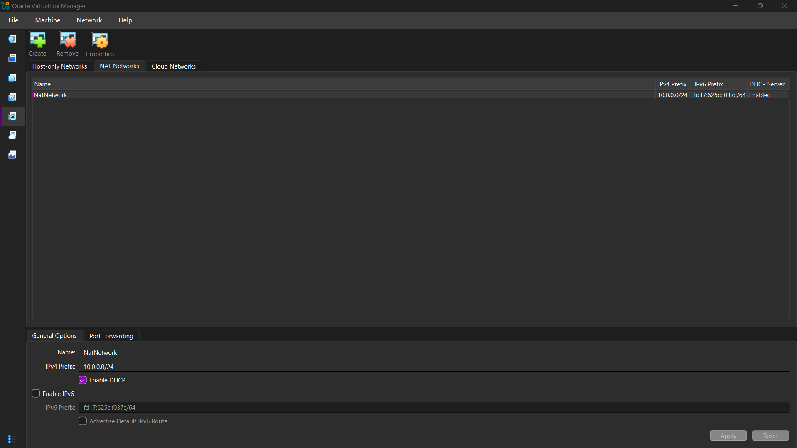
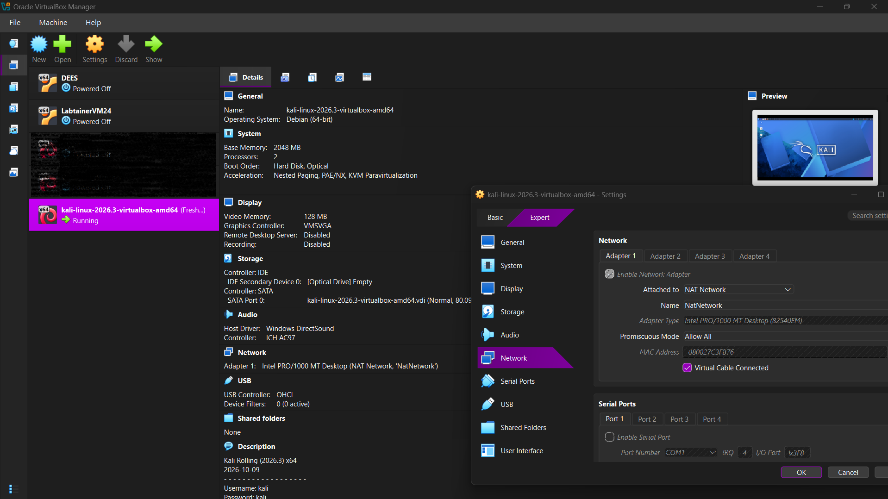
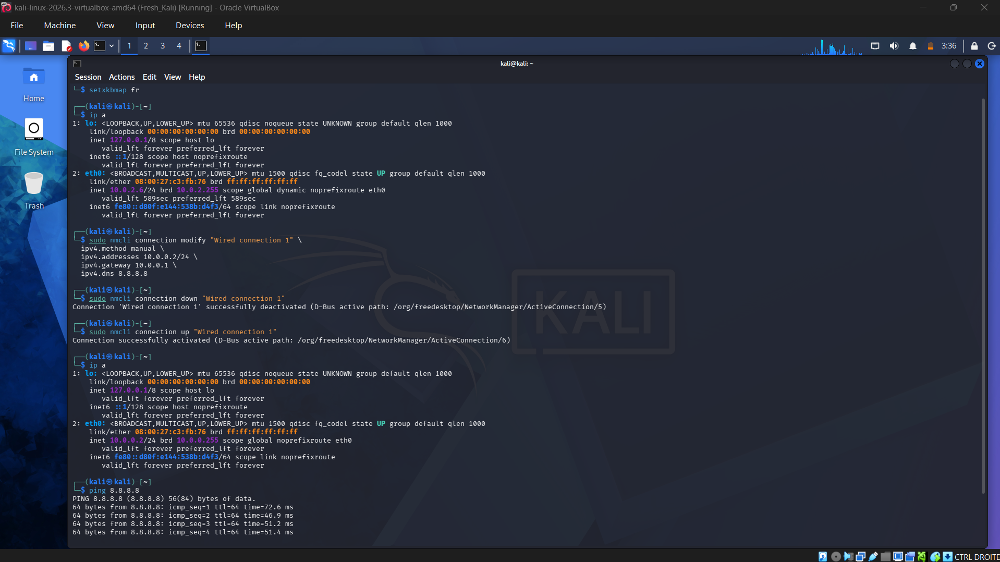

# 🛡️ NetworkWalks B084 - Week 1 Project Module 1

**Cybersecurity Lab Environment Setup: VirtualBox & Kali Linux**

## 📌 Project Overview

This repository documents the complete setup of an isolated cybersecurity and penetration-testing laboratory. The environment is built using Oracle VM VirtualBox and Kali Linux, configured on a custom NAT Network (`10.0.0.0/24`).

The goal is to create a safe, reproducible baseline environment where network scanning, vulnerability assessments, and other ethical hacking practices can be performed. This baseline will serve as the foundation for future target machines (Windows 10, Android) in upcoming weeks.

---

## 🎯 Objectives

- Install and configure VirtualBox and the Extension Pack.
- Create an isolated `NatNetwork` (`10.0.0.0/24`) for lab communications.
- Deploy Kali Linux as the primary attacker/security machine.
- Configure a static IP (`10.0.0.2/24`) with full internet access.
- Enable clipboard sharing and shared folders (`/downloads`) between Host and VM.
- Take a clean baseline snapshot for future rollbacks.
- Document the troubleshooting process for real-world issues encountered.

---

## 🏗️ Lab Architecture & Specifications

| Component             | Configuration                               |
| :-------------------- | :------------------------------------------ |
| **Host OS**           | Windows 10 / 11                             |
| **Hypervisor**        | Oracle VM VirtualBox (v7.x)                 |
| **Security OS**       | Kali Linux (2026.x)                         |
| **Virtual Network**   | NAT Network (`NatNetwork`)                  |
| **Subnet Range**      | `10.0.0.0/24`                               |
| **Kali IP Address**   | `10.0.0.2/24`                               |
| **Gateway**           | `10.0.0.1`                                  |
| **DNS**               | `8.8.8.8`                                   |
| **Future Target VMs** | `10.0.0.9` (Android), `10.0.0.10` (Windows) |

---

## ⚙️ Setup & Configuration Steps

### 1. VirtualBox Network Configuration

- Navigated to **Tools > Network > NAT Networks**.
- Created a network named `NatNetwork`.
- Set the IPv4 Prefix to `10.0.0.0/24`.
- Enabled the DHCP Server.

### 2. VM Hardware & Adapter Setup

- Imported the Kali Linux VM.
- Allocated **2048 MB RAM** and **2 CPU cores**.
- Set **Adapter 1** to `NAT Network` and selected `NatNetwork`.
- Enabled **Bidirectional Clipboard** and **Drag-and-Drop**.
- Added a Shared Folder mapping to the host's `/downloads` directory.

### 3. Static IP Configuration (via Terminal)

To ensure the Kali machine is consistently reachable at the required IP, we used `nmcli` to wipe old DHCP leases and enforce the static configuration:

```bash
sudo nmcli connection modify "Wired connection 1" \
  ipv4.method manual \
  ipv4.addresses 10.0.0.2/24 \
  ipv4.gateway 10.0.0.1 \
  ipv4.dns 8.8.8.8 \
  ipv4.dhcp-timeout 0

sudo nmcli connection down "Wired connection 1"
sudo nmcli connection up "Wired connection 1"
```

---

## ✅ Verifications & Connectivity Tests

After configuration, the following tests were performed successfully to ensure the lab is fully operational:

| Test                 | Command                     | Expected Result       | Status  |
| :------------------- | :-------------------------- | :-------------------- | :------ |
| **Check IP Address** | `ip -br addr`               | `eth0 UP 10.0.0.2/24` | ✅ PASS |
| **Ping Gateway**     | `ping -c 4 10.0.0.1`        | 0% packet loss        | ✅ PASS |
| **Ping Internet**    | `ping -c 4 8.8.8.8`         | 0% packet loss        | ✅ PASS |
| **Verify DNS**       | `nslookup networkwalks.com` | Resolves to IP        | ✅ PASS |

---

## 🛠️ Real-World Troubleshooting Log

### Problem 1: Kali receiving a `10.0.2.x` IP instead of `10.0.0.x`

- **Cause:** The VirtualBox VM adapter was initially attached to the default `NAT` interface rather than the newly created `NAT Network`. Standard NAT in VirtualBox uses the `10.0.2.0/24` subnet by default.
- **Resolution:** Powered off the VM, changed Adapter 1 to `NAT Network` (`NatNetwork`), and rebooted.

### Problem 2: "Ghost" Dual IP Addresses (`10.0.0.2` and `10.0.2.6`)

- **Cause:** After changing the `nmcli` method to `manual`, the NetworkManager kept the old DHCP lease active alongside the new static IP because the `ipv4.addresses` parameter was not fully cleared during the initial switch.
- **Resolution:** We forced the connection to drop the DHCP lease and strictly enforce the static IP using the `ipv4.method manual` combined with `ipv4.dhcp-timeout 0` command listed in the configuration step above.

---

## 📸 Proof of Concepts (PoCs)

### 1. VirtualBox NAT Network Configuration



### 2. Kali Linux Adapter Settings



### 3. Successful IP & Ping Verification



### 4. Clean Baseline Snapshot


---

## 🎓 Key Takeaways

1. **NAT vs. NAT Network:** Learned that standard NAT isolates the VM from other VMs, whereas a NAT Network creates a virtual switch allowing multiple VMs to talk to each other while sharing host internet access.
2. **NetworkManager (nmcli):** Gained hands-on experience modifying connection profiles via the CLI, including clearing stale DHCP leases.
3. **Snapshots:** Learned the importance of taking a "Clean Baseline" snapshot immediately after configuring networking to avoid redoing the setup if the VM gets corrupted.

---

## ⚠️ Ethical Disclaimer

This lab environment is strictly for educational purposes and authorized security testing only. Any scanning or exploitation techniques practiced here must only be applied to systems within this isolated lab or systems where explicit written permission has been granted. Unauthorized access to networks or systems is illegal and strictly prohibited.

---

## 👨‍💻 Author

**[Ohaddou]**  
_Cybersecurity Professional - Cohort B084_  
[LinkedIn Profile](https://www.linkedin.com/in/ayoub-haddaoui/) | [GitHub Profile](https://github.com/Ohaddou)
